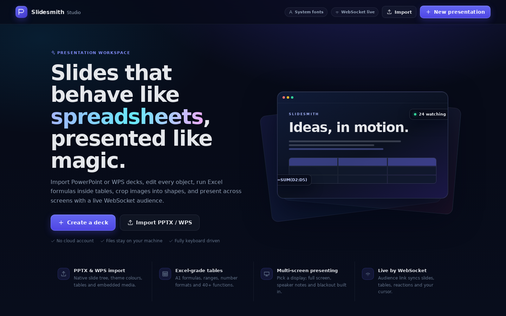

# Slidesmith Studio

A full presentation workspace built with React, Express and WebSockets. It imports PowerPoint/WPS decks,
lets every object be edited, runs an Excel-compatible formula engine inside slide tables, crops images into
shapes, and presents on a chosen display with a live audience that follows over WebSocket.



## Quick start

```bash
npm install
npm run dev        # http://localhost:3000 (Vite middleware + API + WebSocket)
npm run build
npm start          # production server on PORT (default 3000)
npm test           # formula engine, PPTX importer and rich-text tests
```

Data lives in `data/` (decks and uploaded media). On first run a five-slide product tour is generated in
`data/decks/demo.json` with demo imagery and audio.

## Ship it as a single application (one `.exe`)


Build a **single, self-contained executable** that anyone can download and double-click — no Node.js, no
installer, no `npm install` on their machine:

```bash
npm install
npm run build:exe
```

That produces **`build/Slidesmith.exe`** (about 91 MB, Windows). It bundles the Express server, every
dependency, the compiled React client and the Node runtime into one file, with the app icon and version
metadata stamped in.

### Using the packaged app

1. Copy `Slidesmith.exe` anywhere — a folder, a USB stick, a network share.
2. Double-click it. A console window opens and the app appears in its own browser window.
3. Your decks live in `SlidesmithData/` next to the executable. If that folder is read-only (for example
   `Program Files`), the app falls back to `%APPDATA%\Slidesmith Studio`.
4. Close the console window to stop the app.

Command line flags (optional):

| Flag | Effect |
| --- | --- |
| `--port=8080` | Use a specific port (default `3000`; the app steps to the next free port if it is busy) |
| `--no-open` | Start the server without launching a browser window |

Environment overrides: `SLIDESMITH_DATA_DIR` moves the data folder, `SLIDESMITH_NO_OPEN=1` disables the
browser launch, `PORT` sets the port.

### Notes for whoever receives the file

- It is **unsigned**, so Windows SmartScreen may warn on first run: *More info* → *Run anyway*. Sign the
  executable with your own certificate if you distribute it widely.
- The file is large because it embeds the Node.js runtime — that is what removes the install step.
- Builds are per platform: `npm run build:exe` produces a Windows `.exe` on Windows, a macOS binary on macOS
  and a Linux binary on Linux (Node's single-executable packaging cannot cross-compile).
- Legacy binary `.ppt`/`.dps` files still need LibreOffice on the machine running the app; modern `.pptx`
  files import natively with no extra software.

### Verifying a build

`npm run smoke` exercises a running instance end to end — static delivery, the deck API, media upload,
native PPTX import and a live WebSocket room:

```bash
build\Slidesmith.exe --no-open --port=3000    # or: npm run dev
npm run smoke -- http://localhost:3000
```

## What is implemented

### Window & ribbon
- The editor is a **WPS-style window** with **one toolbar row**: *File*, the quick-access cluster, the tab strip
  (*Home / Insert / Design / Transitions / Animations / Slide Show / Review / View / Tools*) and the deck title with
  *Present*.
- **Clicking a tab changes the right-hand column**, not a second toolbar: the active tab's labelled groups
  (Clipboard, Slides, Font, Paragraph, Insert, Arrange, Editing, Background, Slide size, Timing, …) appear as compact
  chips above the inspector. The panel has a chevron in its header to fold it away when the inspector needs the room.
- The **File** button opens the presentation menu (new, open library, save, import, duplicate, export JSON, delete)
  and the quick-access cluster next to it holds save / undo / redo.
- A **document tab strip** sits under the ribbon: every deck you open appears as a tab with its own accent, a × to
  close it (middle-click works too), a **+ New** button and a collapse toggle. Tabs are remembered per browser, so
  the presentations you had open come back the next time the window opens.
- Everything the tab panel does is reachable without it: the inspector carries the detailed controls, **View ▸
  Panels** hides or shows the slide rail, the inspector and the tab strip — hiding the inspector keeps the tab tools
  on screen and hands its space back to the canvas.
- **Slide layouts** (*Home ▸ Layout*) rebuild the current slide as a title slide, title + content, two content,
  section header, picture-right or blank, and **Sections** (*Home ▸ Section*) group slides into named, collapsible
  blocks in the rail.
- **Menus float above everything**: every dropdown (File, Layout, Section, Shapes…) is rendered on a fixed layer on
  top of the window, so it can never be clipped by the ribbon's scroll container, and it flips above the button when
  there is no room below.
- **Format painter**: copy the look of one object (text style, fill, picture fill, border, radius, padding) and
  click another object to paste it.
- **The window itself can wear a picture** (*View ▸ Window picture*): an image, its opacity and blur are painted
  behind the canvas area and remembered per browser.

### PowerPoint / WPS import
- Native OOXML parser (`server/pptx.js`) using JSZip + fast-xml-parser. No cloud or Office runtime needed.
- Slide order and dimensions from `presentation.xml`, theme colours and fonts from `theme1.xml`.
- **Layouts and masters are kept**: a slide with no background of its own inherits the layout's, then the master's —
  solid, **gradient**, pattern and theme (`<p:bgRef>`) fills included — and the decorative pictures that the layout
  and master draw (bands, logos, side art) are imported underneath the slide's own objects, exactly where the design
  put them. Placeholder pictures are skipped, since the slide supplies those.
- **Missing design images are replaced with a similar one.** If a slide points at a background picture that is not in
  the package (linked media, a stripped file), the importer generates a background from the deck's own theme colours
  — same palette, same mood — and uses it, so the layout still reads correctly. The deck keeps its theme
  (`theme.colors`, major/minor fonts) so the editor can do the same on demand
  (*Design ▸ Similar look*, or **Generate a matching background** in the inspector).
- Text boxes keep what makes a slide look designed: **text highlight** (the coloured bands behind words),
  paragraph **space before/after**, **line spacing**, **bullets and auto-numbering** with their hanging indent,
  per-side body **insets**, vertical anchoring and **autofit** shrinking — so lines land where PowerPoint puts them
  instead of piling up at the top of the box.
- Colours resolve through the theme, including the `bg1`/`tx1` aliases and the `lumMod`/`lumOff` tints and shades
  ("lighter 60%") that themed shapes are built from.
- Shapes that inherit their paint are imported as well: **`grpFill`** (a group's fill), **`p:style`** references and
  the theme's **`spDef`** shape defaults — so grouped artwork and default-styled shapes keep their colour.
- **SmartArt** comes in from the drawing PowerPoint renders beside the diagram data (`drawingN.xml`), scaled into the
  frame's box with the diagram's own shapes, colours and text.
- **Online videos play inside the slide.** A YouTube or Vimeo link (PowerPoint's *Insert ▸ Video ▸ Online Video*,
  stored as an external relationship beside a poster frame) is imported as a playable video: the poster frame stands
  in until it is played, then the provider's player runs inside the slide — in the editor, the show, the presenter
  console and the live audience page. `youtu.be/<id>`, `youtube.com/watch?v=<id>`, `/embed/`, `/shorts/`, `/live/`,
  playlists, `vimeo.com/<id>` and start times (`?t=90`, `#t=1m30s`) are all understood.
- Picture fills (`a:blipFill`), outline-only shapes, connectors, tables with grid widths/heights and header fills,
  plus audio/video relationships.
- **The result is checked against the file itself.** `npm run import:check -- <file.pptx>` re-reads the OOXML and
  compares every shape's position, size and text details with what the importer produced, printing any difference
  (add `--slide N` for a single slide). It exits non-zero when something is off, so it can gate a release.
- Placeholder transforms inherited from slide layouts and masters when a slide omits its own position.
- Nested group shapes with coordinate transforms, preset geometry mapping (rect, ellipse, rounded,
  triangle, diamond, stars, hexagons, chevrons, arrows, plus, parallelograms, trapezoids).
- Pictures, backgrounds (including slide layout inheritance), tables with grid widths/heights and header fills,
  plus audio/video relationships.
- **Slide animations** are read from `<p:timing>` — entrance, emphasis, exit and motion-path effects with their
  duration, delay, trigger (`on click` / `with previous` / `after previous`) and click grouping, so a deck plays
  back in the same order it was authored.
- Imported media is extracted to `data/uploads/<deck>/` and served under `/media/...`.
- `.pptx`, `.ppsx`, `.potx` are parsed natively. Legacy binary `.ppt`, `.dps`, `.dpt`, `.pt` are converted with
  LibreOffice when `soffice`/`libreoffice` is installed; otherwise the API returns a clear "save as .pptx" message.

### Font strategy
Fonts are resolved from the host operating system, never bundled from the web. The client:
1. asks Chromium's `queryLocalFonts()` for the installed font families;
2. falls back to canvas-based detection of common system families if permission is unavailable;
3. renders every text style with `"<chosen family>", system-ui, -apple-system, "Segoe UI", …` so a missing
   imported font gracefully uses the system equivalent.

The inspector shows a **system** badge and the editor footer shows the active font source.

### Excel-style tables
`shared/formula.js` is a dependency-free spreadsheet engine:
- A1 references, ranges (`A1:B9`), `$` anchors, arithmetic, comparison, string concatenation and percent.
- Circular-reference detection and Excel error values (`#DIV/0!`, `#VALUE!`, `#REF!`, `#NAME?`, `#N/A`, `#CIRC!`).
- 50+ functions: SUM, AVERAGE, MIN, MAX, MEDIAN, COUNT, COUNTA, COUNTIF, SUMIF, AVERAGEIF, IF, IFERROR,
  AND/OR/NOT, ROUND/ROUNDUP/ROUNDDOWN, ABS, SQRT, POWER, MOD, VLOOKUP, HLOOKUP, INDEX, MATCH, TEXTJOIN,
  CONCAT, LEFT/RIGHT/MID, UPPER/LOWER/PROPER, TRIM, SUBSTITUTE, FIND/SEARCH, TODAY/NOW/DATE/YEAR/MONTH/DAY,
  PMT/FV and more.
- Number formats: general, number, integer, currency (USD/EUR/GBP), percent, date, long date, time, text,
  accounting, scientific, and custom `#,##0.00`-style patterns.
- Spreadsheet editor: formula bar with name box, range selection with mouse/Shift+arrows, bold/italic/underline,
  alignment, font size, text/fill colours, insert/delete rows and columns, header styling and live status
  (count/sum/average). Changes recalculate instantly and persist with the deck.
- Tables are also editable **while presenting**; every cell change is broadcast to the audience in real time.

### Text boxes & rich formatting
- **Double-click anywhere on the canvas** to drop a text box at that point and start typing immediately.
- **Changing the font of a box always shows.** Imported text carries its own `font-family` (and often size and colour)
  inside the spans PowerPoint wrote; setting the family, size or colour of the box now clears those inner values
  first, so the new font actually renders instead of being hidden behind the text's own formatting. The same is true
  for imported `runs`, whose per-run font is dropped when the whole box is restyled.
- While a box is open for editing, its whole rectangle belongs to the editor: clicking the text, the padding or
  the empty space inside it keeps the session alive, so you can select, retype, restyle and reposition the caret
  freely. Only a click **outside** the box commits and closes it.
- A double-click that lands outside never spawns a second box from the click that closed the editor, and a
  double-click inside an object's rectangle never spawns one at all — so nothing is duplicated by accident.
- Edits are saved whenever you click outside the box, press `Esc`, change slide or blur into another control —
  an untouched empty box is discarded automatically.
- Floating format toolbar over the editing box: **font family and font size for the highlighted text**, **Header
  (H1), Sub header (H2), Small header (H3) and Body**, bold, italic, underline, superscript, subscript, numbered
  and bulleted lists, left/centre/right/justify alignment, **highlighting**, text colour, and clear-formatting.
  All of it applies to the current selection and is kept alive while the box stays open; with just a caret (nothing
  highlighted) the font controls restyle the whole box, exactly like the inspector's font section.
- Formatting is stored as sanitized inline HTML on the element (`html` + a plain-text mirror in `text`), so it
  renders identically in the editor, thumbnails, the presenter and the live audience. Imported PPTX runs are
  converted to the same vocabulary, and the inspector can apply highlight/script to a whole box.
- **Pasting into an open box** keeps the caret and the formatting the text came with (a picture on the clipboard is
  put on the slide as an image instead, and a bare video link becomes a video).
- Every value written to a deck passes an allowlist sanitizer (`src/lib/richtext.js`) — scripts, event handlers,
  `javascript:` URLs and `url()` styles can never reach a slide.

### Slide item animations
- Imported decks keep their animations. `server/timing.js` walks the OOXML timing tree, resolves each
  `<p:spTgt spid>` to the shape it points at (a group maps to all of its children) and turns it into a slide
  `animations` timeline: one entry per effect with `kind` (entrance/exit/emphasis/path), `effect`, `direction`,
  `duration`, `delay`, `trigger` and the click `group` it belongs to.
- Playback follows PowerPoint's order: **→** plays the next animation step and only moves to the next slide once
  the timeline is finished; **←** rewinds a step first, then steps back through slides (showing the previous
  slide fully built). Clicking the slide and `Space`/`PageDown` do the same as **→**.
- Every effect the importer can produce has a CSS keyframe — fade, fly, wipe, split, zoom, circle, dissolve,
  peek, crawl, stretch, blinds, box, checkerboard, wheel, spiral, swivel, bounce, bars, strips, diamond, plus,
  wedge, flash, boomerang, appear, motion paths, and the emphasis set (pulse, grow, shrink, spin, color pulse,
  darken, lighten, transparency, underline, bold, italic, blink). Effects share a handful of parameterised
  keyframes, so an unknown preset degrades to a fade instead of being dropped.
- Motion paths keep their real points and move the element along the net displacement, scaled to the slide size.
- The live audience follows the step, not just the slide, so everyone sees each item appear together.
- **Authoring:** select any object → *Animation* in the inspector. Add an Entrance / Emphasis / Exit effect,
  change its kind, effect, direction, start trigger, duration and delay, reorder steps with ↑/↓, and preview the
  timeline on the canvas with the transport in the editor toolbar (play / step back / step forward / show all).
- Steps a deck authored as **auto-playing** (a numeric group delay instead of `delay="indefinite"`) play by
  themselves as soon as the slide appears — no extra click — and only the click steps wait for the presenter.

### Presenting
- **Set Up Show** in the present dialog: pick the display, turn **presenter view** on or off, and build a
  **custom show** (tick the slides to play — the deck itself is never changed).
  - **Presenter view on** (default): the console (notes, timer, annotations, navigator, live panel) opens on your
    display while the audience screen shows only slides.
  - **Presenter view off**: the selected display takes over with the slides full screen and no console — the
    single-monitor / mirror setup.
- **Mirror vs extend is detected for you**: one display (or a primary target) is described as mirror/duplicate mode,
  several displays as extend mode, and the dialog says where each window will appear.
- Present dialog lists displays via the Window Management API (`getScreenDetails()`), showing labels,
  resolutions and primary status.
- **Two windows, two displays.** The presenter console (notes, controls, animation steps, live panel) always opens
  on the **primary display**, where you are working. The **audience output** — the real show, chrome-less and with
  no cursor — opens on the display you selected. They stay in lockstep over a `BroadcastChannel`, including the
  animation step, blackout and fill mode, so the audience screen always matches the console.
- **If you select the primary display**, both windows share it: the console takes the left side and the audience
  output opens as a windowed preview beside it, so you can still see exactly what the room sees.
- **Full screen presentation is on by default** (when the output targets another display): the output window takes
  over that screen like `F11`. `F` (or `F11`) toggles full screen in the console; `Esc` leaves full screen **and
  stops presenting**, returning you to the editor.
- **Ending the show closes its windows.** `Esc` (once nothing else wants it) and *End presentation* both send the
  end signal, which closes the audience window and the console window itself. A browser only lets a script close a
  window it opened, so a show that was opened in the editor's own tab falls back to navigating back to the editor.
- Fallback for browsers without multi-screen APIs plus manual drag/full-screen guidance.
- Presenter view: next/previous with arrows/space, progress bar, timer, speaker notes + next-slide preview,
  blackout, fill-screen toggle, live table editing and instant exit. Clicking the console — or the letterbox area
  of the output window — advances the show, animation step by animation step.
- **On-screen tools while you present** (console toolbar and keyboard):
  - **Annotation tools** — pointer, **laser**, **pen**, **highlighter** (six colours) and an **eraser**, drawn on an
    overlay above the slide. Drawings are kept per slide and mirrored to the audience output *and* the live audience
    page; **Clear** wipes the current slide.
  - **Screen blanking** — `B` blacks the screen out, `W` turns it white, so attention goes back to you. The audience
    output and the live audience follow.
  - **Slide navigator** (`G`) — a thumbnail wall of the running order; click any slide to jump straight to it (also
    within a custom show) without showing the slides in between.
- Custom shows, blanking and annotations all travel with the show: the presenter console, the audience output window
  and the WebSocket audience stay in step.
- Slide backgrounds — solid colour, gradient and images — always paint **edge-to-edge across the display**;
  slide content is letterboxed (or fills the screen with the Fill toggle) without exposing empty bars.
- Click images/video/audio to open an expandable viewer: images zoom (25–600%, wheel, pan), video plays large,
  audio gets a full player.

### Live WebSocket audience
- Presenter hosts a room and receives a six-character code; the audience link appears in the presenter's Live
  panel and is posted back to the share dialog.
- Messages: `host`, `join`, `navigate`, `deck:update`, `table:update`, `pointer`, `blank`, `annotation`, `reaction`,
  `presenting`, `end`.
- Audience pages follow slide changes, receive in-presentation table edits instantly, see the presenter's cursor
  trail, send emoji reactions, and show the live viewer count. Auto-reconnect is built in.
- Editor autosaves are announced over BroadcastChannel; the presenter polls the deck as a fallback and pushes
  updates to the audience, so editing while presenting updates the room live.

### Shapes, containers & picture fills
- 15 shape presets with solid/gradient fills, strokes, radius and centred text.
- Any image can be clipped to any preset shape (CSS `clip-path`) with zoom and X/Y crop controls.
- Select a shape and use **Fill shape with an image** to upload and mask a picture to that exact shape while
  keeping the shape's border and text.
- **Picture fills**: any shape *and* any container (text box) can wear an image as its fill — URL or upload,
  cover / contain / stretch / tile, with its own opacity. Shapes clip the picture to their exact outline with an
  SVG `<pattern>`; containers paint it behind their text. The inspector can also reuse a picture already on the
  slide, or push a picture straight to the slide background.
- Select an image and use **Set this picture as the slide background** to paint it edge-to-edge behind the slide.
- Images keep cover/contain fit, border, radius and opacity controls.

### Custom shapes: corners, the pen and path operations
Everything here works on the shapes you draw and on the ones that arrive in a deck, and the result is still a plain
shape — a fill (or a picture fill), a border, text, rotation and animation all keep working.
- **A radius per corner.** A rectangle carries four independent radii. Drag the dots on the shape itself, or type
  the values in the inspector (top-left · top-right · bottom-right · bottom-left). Radii that would overlap are
  scaled down together the way CSS does, so a corner can never fold over itself, and *Radius (all)* — or the
  ribbon's **Corners** field — sets all four at once. Preset polygons (star, arrow, hexagon…) and custom paths have
  a single **Corner radius** that cuts their sharp corners off.
- **Path operations.** Select two or more shapes (pictures count as their own rectangle) and press **Union**,
  **Subtract**, **Intersect** or **Exclude** — in the ribbon's *Shape tools* group, in the inspector's *Combine
  paths* panel, or from the right-click menu. The lowest shape is the base for Subtract and lends the result its
  fill, border and picture fill; the shapes are replaced by one editable path in the same stacking position, and
  every operation is one undo step.
- **Pen tool.** *Insert ▸ Shape tools ▸ Pen* draws a shape point by point: click for a corner, click-and-drag to pull
  bezier handles out of the point, click the first dot again (or press Enter) to close it, Esc to throw it away and
  Backspace to drop the last point. A shape you leave open is drawn as a line.
- **Vector Edit mode, the Figma way.** Selecting a shape or a picture opens it: the **orange dots sit on the object**
  and the normal selection handles step aside. **Enter** or **Esc** (or a click anywhere off the dots) *locks* the
  custom shape — the object stays selected and the resize handles come back — and **double-click** or **Enter** opens
  the dots again.
  - A **square** sits on every anchor (corner or curve point): drag it to stretch or skew the geometry.
  - A **diamond** sits in the middle of every edge: drag it to bend that edge, the way an image editor's Bend tool
    does; Alt-click it to straighten the edge again.
  - The **outline itself** is a target: hover it for a **"+" cursor and click to drop a new anchor**, or **drag it**
    to pull the edge out into a curve. Alt-click an anchor to remove it.
  - A small round dot appears wherever a point already has curve handles, so the curve can be pulled.
- **Nothing changes until you move a dot.** A rectangle stays a rectangle, a star stays a star and a picture stays a
  picture while the dots are on screen; grabbing one converts that object into an editable path *once* — a picture
  becomes a shape filled with the picture, so the photo survives the reshape — and the whole thing is a single undo
  step. Corner rounding keeps its own controls (the inspector's per-corner grid and the ribbon's *Corners* field),
  which come back on the canvas as the four little dots once the shape is locked.
- **Borders on pictures.** The image section of the inspector has a **Border** colour and a **Border width**, and the
  border follows the corner radius, so a picture can be outlined like any shape. Picking a colour turns a 2 px border
  on straight away, *Remove border* takes it off, and masking the picture into a shape keeps the border with it.
- **Pictures are shapes too.** Selecting a picture and pressing **Edit points** (ribbon, inspector or right-click)
  turns it into a shape *filled* with the picture — a rectangle by default, or the clip shape it already had — so its
  corners, curves and silhouette can be dragged like any other outline. The picture keeps its fit, and once it is a
  path it can be Unioned, Subtracted or Intersected with other shapes just the same.
- **Bend an edge.** Every edge of a path carries a diamond in its middle: drag it and that edge curves through the
  pointer (the Snipping-Tool "Bend" move), Alt-click it to straighten the edge again. Works on shapes, on drawn
  paths and on pictures, because a picture being reshaped *is* a path here.
- **Drop pictures onto pictures.** Drag an image file from anywhere — the file manager, the browser, a screenshot —
  and drop it on empty canvas to place it, or **straight onto a picture or a picture-filled shape to replace what it
  shows**, keeping the size, crop, border and rotation of the object you dropped on. Multi-file drops place each
  file in turn.
- **Masking a picture.** With a picture and a shape selected, **Mask a picture** pours the picture into the shape's
  exact outline — the Figma "use as mask" move. Combine it with the path operations to build an outline (a number, a
  letter, any silhouette) and then fill it with a photo; the picture stays a picture fill, so it survives resizing,
  rotating and animating.
- All of the geometry lives in `src/lib/paths.js` — rings with bezier handles, CSS-style corner clamping, corner
  rounding, flattening and a real polygon clipper (edge splitting, collinear-overlap handling, straightest-continuation
  ring building) — and is unit tested against measured areas in `tests/paths.test.js`.

### Find & replace across the deck
- **Ctrl+H** (or *Home ▸ Editing ▸ Replace*) opens the panel; **Ctrl+F** focuses the find field in the ribbon.
  The search runs over **every slide at once**, and the count tells you how far it reaches:
  “6 in 5 objects on 2 slides”.
- Everything you wrote is covered: text boxes, shape text, **table cells** and the **speaker notes** of every slide.
  Formulas (`=A1+B1`) are deliberately left alone.
- **Enter** jumps to the next match — opening its slide and selecting the object it lives in (Shift+Enter goes back,
  and a match in the notes says so). **Replace** rewrites the object the find is standing on; **Replace all**
  rewrites the whole deck in one undo step, and the deck is saved straight away.
- **Match case** and **Whole words** are one click away, the query is taken literally (`(net)`, `a.b` and `%` are not
  patterns), and rich text keeps its formatting: the replacement goes into the text of the HTML, never into a tag or
  an attribute, and entities are decoded for the match and re-encoded after it. Imported `runs` are rewritten too,
  keeping each run's own formatting.

### Performance & the operating system
- **Drags are coalesced to one update per frame.** Pointer moves arrive far faster than the screen can show them
  (a 500 Hz mouse means 500 renders a second); the newest position is applied once per animation frame instead.
  Measured on a 24-slide / 288-object deck with 200 moves: **1097 ms → 444 ms** of main-thread work for the same
  drag. The pen, node, bend, corner and marquee drags all go through the same path.
- **Saving does not serialise the deck on every change.** A revision counter decides whether a save is needed, and
  the deck is only stringified once per save. The word count and the search index are computed when the deck
  settles, not on every keystroke.
- **The live socket coalesces.** A drawing stroke used to be sent on every mouse move, and the server serialised the
  payload once *per viewer*; now payloads are serialised once for everyone, strokes and the laser pointer are
  coalesced to ~20 a second, and a deck update is skipped when the deck has not actually changed.
- **The app knows which OS it is on** (`shared/platform.js`): the launcher opens the user's browser the way that
  system expects (app window when Chrome/Edge is found, `open` on macOS, `xdg-open` elsewhere), shortcut hints read
  `⌘S` on a Mac and `Ctrl+S` everywhere else (Tools ▸ System shows what was detected), and the startup log names the
  system and architecture.
- **No terminal window beside the app.** Every child process is spawned hidden, and the packaged executable is
  patched to the Windows **GUI subsystem** (`build:exe` prints `subsystem 3 -> 2`), so double-clicking it opens only
  the app. Its console output is mirrored to `SlidesmithData/data/slidesmith.log` instead.

### Online videos
- **Insert ▸ Online video** takes a YouTube or Vimeo link and drops it on the slide at 16:9. Pasting a video link
  anywhere on the canvas does the same thing, and a link that arrives in an imported deck is already a video.
- The slide shows the video's poster frame (the file's own poster, or the provider's thumbnail) with a play badge;
  one click starts the provider's player *inside* the slide — no new window, no download.
- It plays in the editor (and in the expanded viewer), in the slide show, on the presenter console and on the live
  audience page, so the room sees the same video as the presenter.
- Start times in the link are honoured (`?t=90`, `#t=1m30s`), and the inspector links straight to the original
  (`Open the link`). Playing needs an internet connection; the poster frame is shown either way.

### Editor
- **Reorder slides by dragging**: grab any thumbnail in the rail and drop it anywhere in the list (a drop line shows
  exactly where it will land), or use the ↑ / ↓ buttons on a thumbnail. Slides dropped inside a section join that
  section, so sections survive reordering.
- **Zoom with Ctrl/Cmd + wheel** anywhere over the canvas (25%–300%), or use the zoom buttons under the slide and
  *View ▸ Zoom*. A plain wheel still scrolls the canvas, the way you would expect.
- Multi-slide rail with thumbnails, add/duplicate/delete, plus named sections you can collapse.
- **Right-click menus.** Right-click an object for cut/copy/paste, duplicate, delete, z-order and group; right-click
  empty canvas for paste, select-all, a new text box, a picture, a table or an online video; right-click inside a
  text box you are editing for cut/copy/**paste**, select-all, bold/italic/underline and clear-formatting. The menu
  is the app's own — no browser menu, no wrong-target paste — and it flips to stay on screen.
- **Clipboard, including pictures.** `Ctrl+V` goes through the browser's own paste event, so **a screenshot or any
  copied picture becomes an image on the slide** (uploaded like a picture picked from disk) with no permission
  prompt — that is the path screenshots need. The same paste takes formatted text (its formatting is kept and
  sanitised), plain text (a text box), a video link (a video) and the app's own objects. `Ctrl+C` / `Ctrl+X` and the
  ribbon's Clipboard group copy objects into the app's own clipboard, so a paste rebuilds them with fresh ids, an
  offset and their own group; the text of what you copy also goes to the system clipboard for other programs.
- Right-clicking empty canvas or an object also offers **Paste picture from the clipboard** and
  **Paste text from the clipboard**, which read the system clipboard directly (placed where you right-clicked).
  Browsers only allow that read from an explicit action, so it always comes from a menu click or a keypress — and if
  the browser refuses, the app says so instead of failing silently.
- Ribbon tabs (Home, Insert, Design, Transitions, Animations, Slide Show, Review, View, Tools) drive the common
  commands: slides and layouts, font and paragraph formatting, shapes / pictures / media / tables, arrange,
  backgrounds, transitions, animations, presenting, notes, zoom, panels and tools.
- Drag, resize (8 handles), rotate, nudge with arrows, duplicate/delete, undo/redo with 80 steps.
- Drag-and-drop images/video/audio onto the canvas; media uploads go through the server.
- Double-click the canvas to write, double-click a box to re-edit; formatting from the floating toolbar.
- Slide background designer: colour, **gradient presets** (linear/radial with start/end colours and angle), image
  upload/URL, cover/contain/stretch, opacity and blur.
- Speaker notes and slide transitions.
- Autosave (debounced) with save-state indicator and manual Ctrl/Cmd+S.

## Keyboard shortcuts

| Context | Shortcut | Action |
| --- | --- | --- |
| Editor | `Ctrl/Cmd+Z` / `Shift+Ctrl/Cmd+Z` | Undo / redo |
| Editor | `Ctrl/Cmd+D` | Duplicate selection |
| Editor | `Delete` | Delete selection |
| Editor | Arrows / `Shift`+arrows | Nudge 1px / 10px |
| Editor | `PageUp` / `PageDown` | Previous / next slide |
| Editor | `Ctrl/Cmd+S` | Save now |
| Editor | `F5` | Present dialog |
| Editor | drag a thumbnail | Reorder slides (↑ / ↓ buttons do the same) |
| Text box | double-click canvas | Create a text box at that point and edit it |
| Text box | `Ctrl/Cmd+B` / `I` / `U` | Bold / italic / underline the selection |
| Text box | `Esc` / `Ctrl/Cmd+Enter` / click outside | Save and close the editor |
| Spreadsheet | Arrows / `Shift`+arrows | Move / select range |
| Spreadsheet | `Enter` / `F2` / double-click | Edit cell |
| Spreadsheet | `Tab` / `Shift+Tab` | Next / previous cell |
| Presenter | `←` `→` `Space` `PageUp/Down` | Previous / next animation step, then slide |
| Presenter | click console (or output letterbox) | Next animation step, then slide |
| Presenter | `N` / `B` / `L` / `H` / `F` | Notes / blackout / live panel / hide chrome / full screen |
| Presenter | `W` | White screen (blanking) |
| Presenter | `G` | Slide navigator (thumbnail wall) |
| Presenter | `Ctrl+L` / `Ctrl+P` / `Ctrl+H` / `Ctrl+E` / `Ctrl+A` | Laser / pen / highlighter / eraser / arrow pointer |
| Presenter | `F11` | Full screen (browser full screen works too) |
| Presenter | `Esc` | Close an overlay, otherwise leave full screen and stop presenting |

## Architecture

```
server/
  index.js      Express API, media storage, deck persistence, WebSocket rooms, client delivery, app bootstrap
  standalone.js Entry point for the packaged executable (sets production + packaged flags)
  pptx.js       Native PPTX parser (EMU→px, theme, groups, text, pictures, tables, backgrounds, animations)
  timing.js     OOXML `<p:timing>` reader: click groups, auto steps, effects, directions and motion paths
  demo.js       Generated first-run demo deck and assets (SVG scenery + WAV chime)
  generated/    Inlined client build written by scripts/embed-client.mjs (git-ignored)
shared/
  formula.js    Spreadsheet parser/evaluator, functions, number formatting, table helpers
  animations.js Animation vocabulary shared by the importer and the editor (effects, presets, steps)
  backgrounds.js Generated "similar" backgrounds from a theme palette (importer + editor)
src/
  App.jsx       Tiny history router (/ , /edit/:id , /present/:id , /live/:code)
  pages/        Home, Editor, Presenter, LiveAudience
  components/   Ribbon + DocumentTabs + Popover (window chrome), AnnotationLayer, Canvas,
                SlideView/ElementView, TextToolbar, TableEditor, Inspector, PresentDialog, Stage, Lightbox…
  hooks/        Undo/redo deck history, open document tabs (localStorage), workspace picture
  lib/          API client, element factories, rich-text sanitizer, backgrounds/picture fills, animations,
                annotations, shapes, fonts, ribbon model, slide layouts
scripts/
  build-exe.mjs     Bundles the server, makes the SEA blob and injects it into the Node runtime
  embed-client.mjs  Inlines dist/ into server/generated/client-assets.js
  make-icon.mjs     Draws the app icon (build/icon.ico + a PNG preview)
  start-server.mjs  Cross-platform `npm start`
  smoke-test.mjs    End-to-end checks against a running instance
tests/          Node test suites for formulas, PPTX import, rich text, the ribbon/layout model, picture fills
                and presenting annotations
```

### Scripts

| Script | Purpose |
| --- | --- |
| `npm run dev` | Development server (Vite middleware, hot reload) |
| `npm run build` | Compile the client into `dist/` |
| `npm start` | Production server serving `dist/` |
| `npm run build:exe` | Build the single-file application in `build/` |
| `npm run preview:app` | Run the packaged code path without building an executable |
| `npm run smoke` | End-to-end checks against a running instance |
| `npm run import:check -- <file.pptx>` | Compare an imported deck with the PowerPoint file, shape by shape |
| `npm test` | Unit/integration test suites |

### API

| Method | Path | Purpose |
| --- | --- | --- |
| `GET` | `/api/health` | Service + converter status |
| `GET` | `/api/decks` | Deck summaries |
| `GET` | `/api/decks/:id` | Full deck JSON |
| `POST` | `/api/decks` | Create/save a deck |
| `DELETE` | `/api/decks/:id` | Delete a deck and its media |
| `POST` | `/api/import` | Import `.pptx`/`.ppt`/`.dps`/`.dpt` (multipart field `file`) |
| `POST` | `/api/decks/:id/assets` | Upload media for a deck |
| `GET` | `/api/fonts` | System font stacks + fallback family list |
| `WS` | `/ws` | Live presentation rooms |

## Notes & limits

- Legacy `.ppt`/`.dps` conversion depends on LibreOffice being installed on the server. Modern `.pptx` files
  (including WPS files saved in PowerPoint format) import natively.
- Very exotic OOXML features (SmartArt, charts, animations, embedded OLE) are not reconstructed as editable
  objects; text, shapes, images, media and tables are.
- Video playback in the packaged demo points at a public sample MP4; upload your own media for offline decks.
- The app has no authentication. It is intended for local/trusted-network use, with decks and uploads stored on
  the server.

